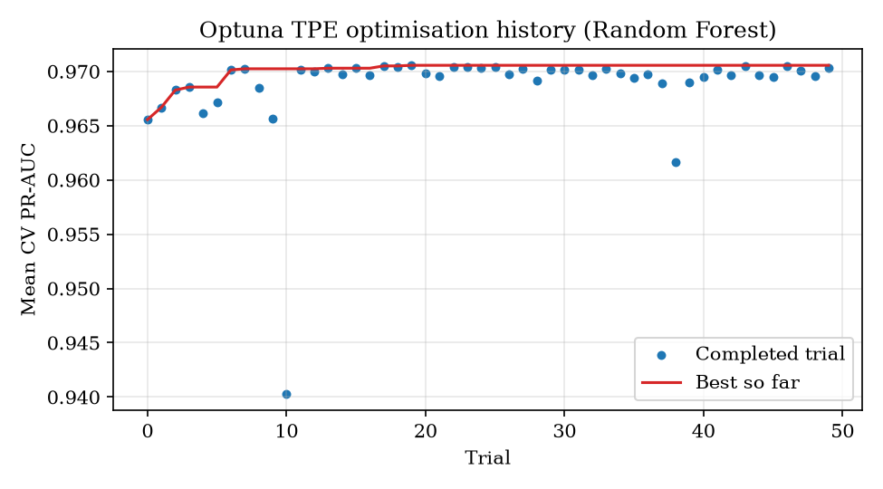
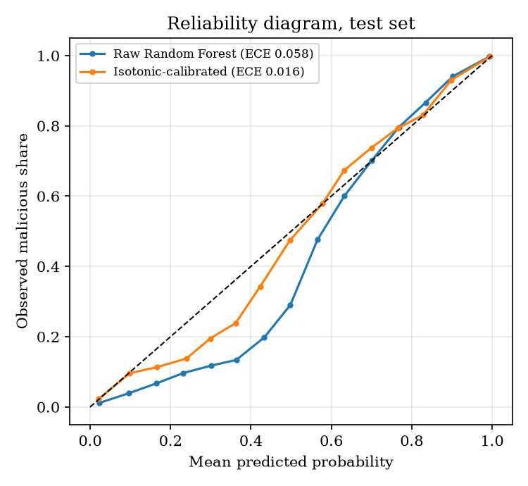
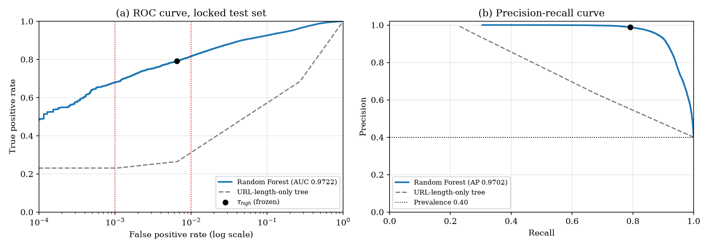
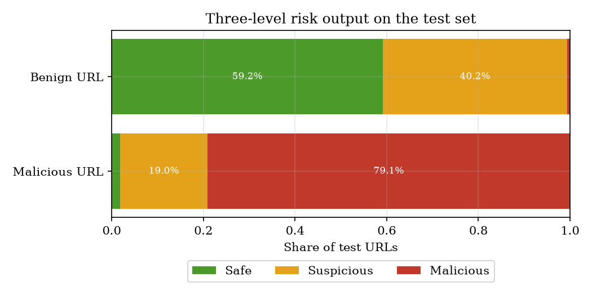
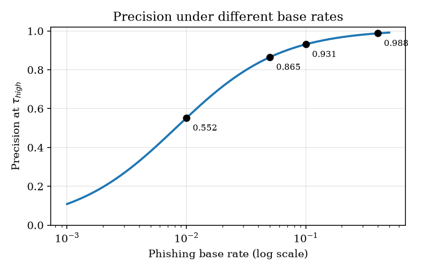
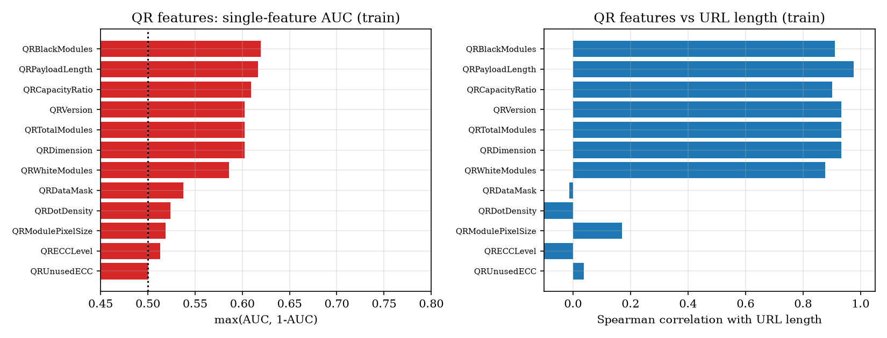
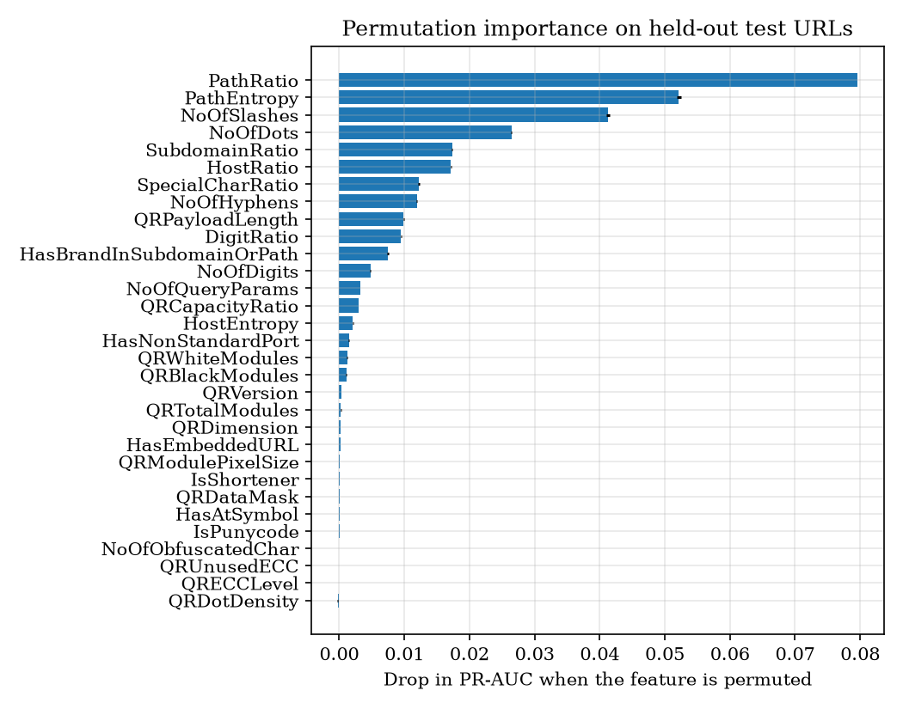
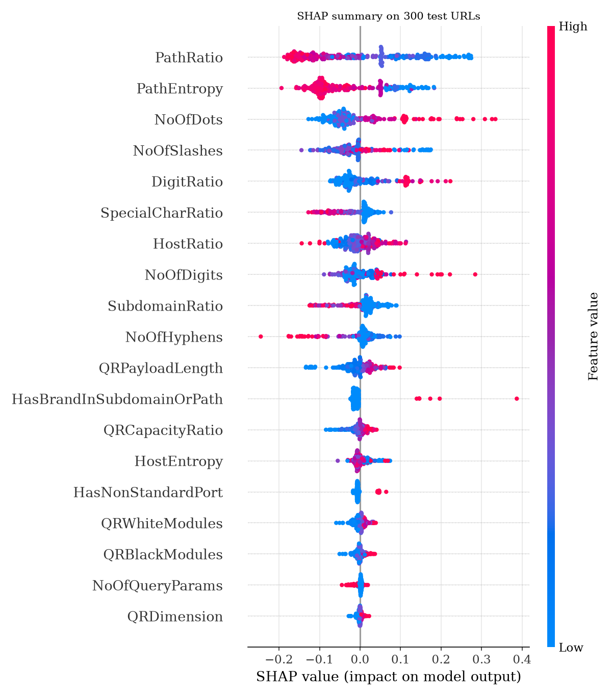

# EXPERIMENTAL REPORT

Model 2b: Random Forest on URL + QR features (31 features)  
Hybrid-Guard, same protocol as Model 2 (Chapter 3) · model version 1e1f85cb77d3

## 1. Summary of findings

- A Random Forest was re-tuned and trained from scratch on Dataset_Hybrid.csv using 19 URL features and 12 non-constant QR features (31 inputs), then evaluated once on the locked test partition of 130,154 URLs (no registered domain shared with the 520,616 training URLs). Every step follows RandomForest_Model2_Report: grouped 5-fold CV, 50 Optuna trials without pruner, isotonic calibration on OOF, frozen thresholds, domain-cluster bootstrap.
- Ranking quality: ROC-AUC 0.9722 [0.9654, 0.9776], PR-AUC 0.9702 [0.9597, 0.9777]. URL-only Random Forest: ROC-AUC 0.9634, PR-AUC 0.9599.
- Primary operating metric: TPR at 1% FPR = 81.59% [79.96%, 83.40%] (URL only: 78.24%); TPR at 0.1% FPR = 67.94% [65.73%, 70.62%] (URL only: 61.52%).
- At the frozen τ_high = 0.8489: precision 0.9878, recall 0.7913, F1 0.8787, MCC 0.8239, FPR 0.65%. URL only: precision 0.9907, recall 0.7431, F1 0.8492.
- Three-level output: coverage 68.3% (URL only 63.8%).
- Calibration: test ECE 0.058 raw → 0.016 calibrated.
- Key finding on QR vs URL: QR features alone are weak, and the gain from adding them to URL features comes almost entirely from one column, QRPayloadLength, which equals the absolute length of the raw URL (Section 9).
## 2. Experimental setup

### 2.1 Data and split

Dataset_Hybrid.csv: 650,770 URLs, 60% benign / 40% malicious, 43 columns. The partition column assigns every registered domain wholly to train or test. Five StratifiedGroupKFold folds grouped by registered domain are used for every tuning trial and for OOF predictions.

Table R1. Data partitions

| Partition | URLs | Malicious URLs | Malicious share | Registered domains |
|---|---|---|---|---|
| Training | 520,616 | 208,246 | 0.4000 | 227,690 |
| Test (locked) | 130,154 | 52,062 | 0.4000 | 57,000 |
| Total | 650,770 | 260,308 | 0.4000 | 284,690 |

### 2.2 Features

URL features (19): HostRatio, PathRatio, NoOfDots, NoOfHyphens, NoOfDigits, NoOfSlashes, NoOfQueryParams, DigitRatio, SpecialCharRatio, NoOfObfuscatedChar, HostEntropy, PathEntropy, HasAtSymbol, SubdomainRatio, IsPunycode, HasNonStandardPort, HasBrandInSubdomainOrPath, IsShortener, HasEmbeddedURL.

QR features (12): QRVersion, QRDimension, QRTotalModules, QRBlackModules, QRWhiteModules, QRDotDensity, QRECCLevel, QRDataMask, QRUnusedECC, QRPayloadLength, QRCapacityRatio, QRModulePixelSize. HasValidQR and QRImageAspectRatio are constant (always 1) and are excluded.

### 2.3 Training protocol

- Tuning: Optuna TPE, 50 trials, objective = mean PR-AUC over the five grouped folds, class_weight="balanced", NopPruner, seed 42. Unlike experiment E8, hyper-parameters are re-tuned for the 31-feature set.
- Refit on the whole training partition; isotonic calibration on OOF predictions.
- τ_high: lowest calibrated OOF score with FPR ≤ 1%; τ_low: highest calibrated OOF score with FNR ≤ 2%. Shortener / embedded-URL URLs are never Safe.
- Test set used once, after everything was frozen.
## 3. Hyperparameter tuning

50 trials completed in 140 minutes. Best trial #19 reached mean CV PR-AUC 0.9706 (URL only: 0.9636).

Table R2. Search space and selected hyperparameters

| Hyperparameter | Search range | URL+QR (selected) | URL only (selected) |
|---|---|---|---|
| n_estimators | 100–300 | 260 | 273 |
| max_depth | unlimited or 8–40 | 33 | 36 |
| max_features | sqrt, log2, 0.3, 0.5, 0.8 | 0.3 | 0.3 |
| min_samples_leaf | 3–30 | 3 | 3 |
| min_samples_split | 2–20 | 9 | 3 |

Figure R1. Optuna optimisation history (URL+QR)

Table R3. Out-of-fold performance (grouped 5-fold CV), URL+QR

| Fold | Validation URLs | ROC-AUC | PR-AUC | TPR@1%FPR | TPR@0.1%FPR |
|---|---|---|---|---|---|
| 1 | 104,125.0000 | 0.9754872134688208 | 0.9720755293619272 | 0.7843937575030012 | 0.643673469387755 |
| 2 | 104,123.0000 | 0.9743851704932605 | 0.9712770452108004 | 0.7888064539364691 | 0.6398953156138203 |
| 3 | 104,124.0000 | 0.9741987326031349 | 0.9715167092302693 | 0.8099399759903961 | 0.6541176470588236 |
| 4 | 104,122.0000 | 0.975837922519396 | 0.9721786856208197 | 0.7901510240341905 | 0.6536531489351485 |
| 5 | 104,122.0000 | 0.9702760872149399 | 0.9657700233215976 | 0.7344410295812523 | 0.5973155973876296 |
| Mean ± SD |  | 0.9740 ± 0.0022 | 0.9706 ± 0.0027 | 0.7815 ± 0.0281 | 0.6377 ± 0.0234 |

Table R3b. Out-of-fold performance, URL only (for comparison)

| Fold | Validation URLs | ROC-AUC | PR-AUC | TPR@1%FPR | TPR@0.1%FPR |
|---|---|---|---|---|---|
| 1 | 104,125.0000 | 0.9686409132680684 | 0.9641125711155923 | 0.7494597839135654 | 0.5682593037214886 |
| 2 | 104,123.0000 | 0.9699517116818501 | 0.9656388687525047 | 0.7659007419145718 | 0.5357391534010421 |
| 3 | 104,124.0000 | 0.9675216496304959 | 0.9640031700853169 | 0.7669627851140456 | 0.5783913565426171 |
| 4 | 104,122.0000 | 0.9705832396173216 | 0.9654879164330249 | 0.7512065115609018 | 0.5607577612907872 |
| 5 | 104,122.0000 | 0.9639643495458996 | 0.9587025537530616 | 0.7245245870149827 | 0.5292210910487899 |
| Mean ± SD |  | 0.9681 ± 0.0026 | 0.9636 ± 0.0028 | 0.7516 ± 0.0172 | 0.5545 ± 0.0212 |

## 4. Calibration and frozen thresholds

On OOF predictions, τ_high = 0.8489 gives FPR 0.98%, τ_low = 0.0548 gives FNR 1.93%. Test ECE: raw 0.058, calibrated 0.016; Brier 0.0614 → 0.0535.

Figure R2. Reliability diagram on the locked test set

## 5. Results on the locked test set

Table R4. Test-set performance of Random Forest URL+QR (n = 130,154), with URL-only value for reference

| Metric | Value | 95% CI | URL only |
|---|---|---|---|
| ROC-AUC | 0.9722 | [0.9654, 0.9776] | 0.9634 |
| PR-AUC | 0.9702 | [0.9597, 0.9777] | 0.9599 |
| TPR@1%FPR | 0.8159 | [0.7996, 0.8340] | 0.7824 |
| TPR@0.1%FPR | 0.6794 | [0.6573, 0.7062] | 0.6152 |
| Precision | 0.9878 | [0.9858, 0.9895] | 0.9907 |
| Recall (TPR) | 0.7913 | [0.7822, 0.8001] | 0.7431 |
| F1-score | 0.8787 | [0.8728, 0.8842] | 0.8492 |
| MCC | 0.8239 | [0.8093, 0.8378] | 0.7894 |
| FPR | 0.0065 | [0.0049, 0.0084] | 0.0047 |
| FNR | 0.2087 | [0.1999, 0.2178] | 0.2569 |
| Accuracy | 0.9126 | [0.9007, 0.9260] | 0.8944 |
| Brier score (calibrated) | 0.0535 | [0.0505, 0.0566] | 0.0659 |

At τ_high: 41,198 true positives, 507 false positives, 10,864 false negatives, 77,585 true negatives (URL only: 38,686 / 365 / 13,376 / 77,727).

Figure R3. ROC (log FPR) and precision-recall; dot = τ_high

## 6. Three-level risk output

Table R5. Risk levels on the test set, URL+QR

| True class | Safe | Suspicious | Malicious | Total |
|---|---|---|---|---|
| Benign | 46,219 (59.2%) | 31,366 (40.2%) | 507 (0.6%) | 78,092 |
| Malicious | 977 (1.9%) | 9,887 (19.0%) | 41,198 (79.1%) | 52,062 |

Table R5b. Risk levels, URL only

| True class | Safe | Suspicious | Malicious | Total |
|---|---|---|---|---|
| Benign | 42,959 (55.0%) | 34,768 (44.5%) | 365 (0.5%) | 78,092 |
| Malicious | 1,003 (1.9%) | 12,373 (23.8%) | 38,686 (74.3%) | 52,062 |

Figure R4. Share of each risk level per class

## 7. Precision under realistic base rates

Table R6. Precision and false alarms at different base rates (URL+QR)

| Phishing base rate | Precision at tau_high | PR-AUC | False alarms / 10,000 benign scans |
|---|---|---|---|
| 40% | 0.9878 | 0.9702 | 64.9234 |
| 10% | 0.9312 | 0.9150 | 64.9234 |
| 5% | 0.8651 | 0.8830 | 64.9234 |
| 1% | 0.5518 | 0.7953 | 64.9234 |

Figure R5. Precision vs base rate

## 8. Shortcut audit, split sensitivity and strata

Table R7. Reference models

| Model | ROC-AUC | PR-AUC | TPR@1%FPR | F1-score |
|---|---|---|---|---|
| Majority class (always benign) | 0.5000 | 0.4000 | 0.0000 | 0.0000 |
| URL-length-only tree (depth 2) | 0.7412 | 0.6516 | 0.2645 | 0.6551 |
| Random Forest (19 URL + 12 QR features) | 0.9722 | 0.9702 | 0.8159 | 0.8787 |

Table R8. Single-feature ROC-AUC on training partition (top 12; QR features included)

| Feature | AUC | max(AUC,1-AUC) | Flag (>0.95) |
|---|---|---|---|
| PathRatio | 0.2115 | 0.7885 | No |
| PathEntropy | 0.2605 | 0.7395 | No |
| HostRatio | 0.7301 | 0.7301 | No |
| NoOfSlashes | 0.2752 | 0.7248 | No |
| NoOfDots | 0.6813 | 0.6813 | No |
| QRBlackModules | 0.3807 | 0.6193 | No |
| QRPayloadLength | 0.3834 | 0.6166 | No |
| QRCapacityRatio | 0.3908 | 0.6092 | No |
| DigitRatio | 0.6045 | 0.6045 | No |
| HasNonStandardPort | 0.6037 | 0.6037 | No |
| QRTotalModules | 0.3975 | 0.6025 | No |
| QRDimension | 0.3975 | 0.6025 | No |

Table R9. Effect of the split strategy (E3)

| Split | Test URLs on training domains | ROC-AUC | PR-AUC | TPR@1%FPR | TPR@0.1%FPR |
|---|---|---|---|---|---|
| Grouped by registered domain (thesis) | 0.0000 | 0.9722 | 0.9702 | 0.8159 | 0.6794 |
| Random URL-level split | 0.6284 | 0.9849 | 0.9817 | 0.8420 | 0.6885 |

Table R10. Performance by stratum

| Stratum | URLs | Malicious share | Recall | FPR | FNR | PR-AUC | Safe share |
|---|---|---|---|---|---|---|---|
| Hard URLs | 913 | 0.9551 | 0.8372 | 0.4878 | 0.1628 | 0.9891 | 0.0000 |
| Other URLs | 129,241 | 0.3961 | 0.7905 | 0.0062 | 0.2095 | 0.9697 | 0.3652 |
| Path depth 0-1 | 74,317 | 0.5142 | 0.8924 | 0.0086 | 0.1076 | 0.9881 | 0.2567 |
| Path depth 2-3 | 42,240 | 0.2149 | 0.4744 | 0.0028 | 0.5256 | 0.8756 | 0.5445 |
| Path depth >=4 | 13,597 | 0.3506 | 0.5849 | 0.0120 | 0.4151 | 0.9252 | 0.3766 |

## 9. Làm rõ số liệu QR và URL

### 9.1 Ba cấu hình cạnh nhau

Bảng Q1. So sánh URL, QR và URL+QR trên test

| Cấu hình | ROC-AUC | PR-AUC | TPR@1%FPR | TPR@0.1%FPR |
|---|---|---|---|---|
| URL only (19), E8 | 0.9634 | 0.9599 | 0.7824 | 0.6152 |
| QR only (12), E8 | 0.6832 | 0.6002 | 0.0762 | 0.0264 |
| QRPayloadLength only (1), E8 | 0.6563 | 0.5698 | 0.0522 | 0.0164 |
| URL + QR (31), E8 (tham số của URL only) | 0.9717 | 0.9696 | 0.8174 | 0.6836 |
| URL + QR (31), báo cáo này (tune lại) | 0.9722 | 0.9702 | 0.8159 | 0.6794 |

Chỉ dùng QR phát hiện kém: tại FPR 1% chỉ bắt được khoảng 7,6% URL độc hại, thấp hơn cả cây độ sâu 2 chỉ dùng độ dài URL (26,5%). URL + QR cao hơn URL only một mức nhỏ. Dòng cuối (đã tune lại) cho biết việc tune riêng cho 31 đặc trưng thay đổi kết quả bao nhiêu so với dùng lại tham số của mô hình URL.

### 9.2 Chênh lệch có ý nghĩa thống kê không

Bảng Q2. Chênh lệch so với URL only (bootstrap ghép cặp theo domain, từ E8)

| Configuration | ROC-AUC | PR-AUC | TPR@1%FPR | TPR@0.1%FPR |
|---|---|---|---|---|
| Logistic regression (19 URL) | -0.0639 [-0.0846, -0.0403] | -0.0871 [-0.0974, -0.0739] | -0.3767 [-0.3935, -0.3593] | -0.3516 [-0.3926, -0.2887] |
| QR only (12) | -0.2801 [-0.3190, -0.2485] | -0.3597 [-0.4536, -0.2835] | -0.7062 [-0.7298, -0.6757] | -0.5887 [-0.6234, -0.5411] |
| QRPayloadLength only (1) | -0.3071 [-0.3345, -0.2806] | -0.3900 [-0.4354, -0.3451] | -0.7301 [-0.7520, -0.7152] | -0.5987 [-0.6316, -0.5500] |
| URL + QR (31) | +0.0083 [+0.0056, +0.0118] | +0.0098 [+0.0060, +0.0153] | +0.0350 [+0.0257, +0.0446] | +0.0684 [+0.0435, +0.1044] |
| URL-length-only tree (depth 2) | -0.2221 [-0.2691, -0.1882] | -0.3082 [-0.3791, -0.2501] | -0.5178 [-0.5403, -0.4965] | -0.6152 [-0.6305, -0.3771] |

Mọi CI đều không chứa 0: URL+QR tốt hơn URL only một cách nhất quán nhưng nhỏ (PR-AUC khoảng +0,01); QR only kém hơn rất nhiều.

### 9.3 Từng cột QR mang thông tin gì

Bảng Q3. Chẩn đoán 14 cột QR (tập train)

| Feature | Mean benign | Mean malicious | Distinct values | max(AUC,1-AUC) | Spearman vs URL length |
|---|---|---|---|---|---|
| QRVersion | 3.1011 | 2.8407 | 31 | 0.6025 | 0.9328 |
| QRDimension | 29.4046 | 28.3628 | 31 | 0.6025 | 0.9328 |
| QRTotalModules | 885.8460 | 846.4849 | 31 | 0.6025 | 0.9328 |
| QRBlackModules | 454.3644 | 433.1518 | 1,547 | 0.6193 | 0.9103 |
| QRWhiteModules | 431.4816 | 413.3331 | 1,546 | 0.5857 | 0.8769 |
| QRDotDensity | 0.5139 | 0.5128 | 1,539 | 0.5237 | -0.1538 |
| QRECCLevel | 0.5154 | 0.5490 | 3 | 0.5132 | -0.2851 |
| QRDataMask | 3.4888 | 3.7582 | 8 | 0.5376 | -0.0125 |
| QRUnusedECC | 1.0000 | 0.9995 | 3 | 0.5007 | 0.0380 |
| QRPayloadLength | 46.9970 | 43.4102 | 601 | 0.6166 | 0.9759 |
| QRCapacityRatio | 0.0504 | 0.0465 | 985 | 0.6092 | 0.9017 |
| QRModulePixelSize | 5.9709 | 5.9116 | 4 | 0.5187 | 0.1703 |
| QRImageAspectRatio | 1.0000 | 1.0000 | 1 |  |  |
| HasValidQR | 1.0000 | 1.0000 | 1 |  |  |

Hình Q1. AUC đơn lẻ (trái) và tương quan hạng với độ dài URL (phải)

Bảy cột (QRVersion, QRDimension, QRTotalModules, QRBlack/WhiteModules, QRPayloadLength, QRCapacityRatio) có tương quan 0,88–0,98 với độ dài URL: chúng là cùng một thông tin (độ dài) viết theo nhiều cách. Các cột không phụ thuộc độ dài (QRDataMask, QRDotDensity, QRECCLevel, QRModulePixelSize, QRUnusedECC) có AUC đơn lẻ gần 0,5, tức gần như không mang tín hiệu.

### 9.4 Mô hình URL+QR dựa vào đặc trưng nào

Bảng Q4. Tầm quan trọng đặc trưng của RF URL+QR (permutation trên test)

| Feature | Permutation dPR-AUC | Permutation SD | Gini share | Mean \|SHAP\| (prob. units) | Nhóm |
|---|---|---|---|---|---|
| PathRatio | 0.0796 | 0.0000 | 0.1962 | 0.1134 | URL |
| PathEntropy | 0.0521 | 0.0003 | 0.1182 | 0.0859 | URL |
| NoOfSlashes | 0.0413 | 0.0002 | 0.0757 | 0.0435 | URL |
| NoOfDots | 0.0264 | 0.0000 | 0.0872 | 0.0610 | URL |
| SubdomainRatio | 0.0173 | 0.0001 | 0.0435 | 0.0302 | URL |
| HostRatio | 0.0171 | 0.0001 | 0.0855 | 0.0311 | URL |
| SpecialCharRatio | 0.0122 | 0.0001 | 0.0239 | 0.0319 | URL |
| NoOfHyphens | 0.0119 | 0.0000 | 0.0266 | 0.0265 | URL |
| QRPayloadLength | 0.0099 | 0.0001 | 0.0413 | 0.0243 | QR |
| DigitRatio | 0.0095 | 0.0001 | 0.0655 | 0.0420 | URL |
| HasBrandInSubdomainOrPath | 0.0075 | 0.0001 | 0.0302 | 0.0143 | URL |
| NoOfDigits | 0.0048 | 0.0001 | 0.0514 | 0.0310 | URL |
| NoOfQueryParams | 0.0032 | 0.0000 | 0.0063 | 0.0052 | URL |
| QRCapacityRatio | 0.0030 | 0.0000 | 0.0223 | 0.0119 | QR |
| HostEntropy | 0.0021 | 0.0000 | 0.0379 | 0.0115 | URL |
| HasNonStandardPort | 0.0015 | 0.0000 | 0.0150 | 0.0105 | URL |
| QRWhiteModules | 0.0012 | 0.0001 | 0.0183 | 0.0087 | QR |
| QRBlackModules | 0.0011 | 0.0000 | 0.0182 | 0.0076 | QR |
| QRVersion | 0.0003 | 0.0000 | 0.0044 | 0.0031 | QR |
| QRTotalModules | 0.0003 | 0.0000 | 0.0049 | 0.0034 | QR |
| QRDimension | 0.0002 | 0.0000 | 0.0050 | 0.0035 | QR |
| HasEmbeddedURL | 0.0002 | 0.0000 | 0.0010 | 0.0004 | URL |
| QRModulePixelSize | 0.0001 | 0.0000 | 0.0009 | 0.0004 | QR |
| IsShortener | 0.0001 | 0.0000 | 0.0015 | 0.0006 | URL |
| QRDataMask | 0.0001 | 0.0000 | 0.0075 | 0.0024 | QR |
| HasAtSymbol | 0.0000 | 0.0000 | 0.0001 | 0.0001 | URL |
| IsPunycode | 0.0000 | 0.0000 | 0.0001 | 0.0000 | URL |
| NoOfObfuscatedChar | 0.0000 | 0.0000 | 0.0000 | 0.0000 | URL |
| QRUnusedECC | -0.0000 | 0.0000 | 0.0000 | 0.0000 | QR |
| QRECCLevel | -0.0001 | 0.0000 | 0.0025 | 0.0019 | QR |
| QRDotDensity | -0.0003 | 0.0000 | 0.0087 | 0.0019 | QR |

Hình Q2. Permutation importance (URL+QR)

Trong nhóm URL, ba đặc trưng đầu: PathRatio (0.0796), PathEntropy (0.0521), NoOfSlashes (0.0413). Trong nhóm QR, ba đặc trưng đầu: QRPayloadLength (0.0099), QRCapacityRatio (0.0030), QRWhiteModules (0.0012).

Hình Q3. SHAP summary (URL+QR)

### 9.5 Vì sao URL + QR tăng

Kiểm tra E8b: chỉ thêm một cột QRPayloadLength vào 19 đặc trưng URL cho PR-AUC 0.9689 và TPR@1%FPR 0.8161, gần bằng cả 12 cột QR. Cột này bằng len(url_raw) ở 99,99% số dòng, tức độ dài tuyệt đối của URL. Mô hình URL only chỉ dùng tỷ lệ (HostRatio, PathRatio, …) nên không có độ dài tuyệt đối. Ảnh QR trong dataset được sinh từ chính URL, nên QR không thêm thông tin nào ngoài URL.

## 10. Latency

Table R12. Latency, URL+QR (QR features assumed precomputed; QR decoding time not included)

| Stage | Median ms | p95 ms | p99 ms |
|---|---|---|---|
| Feature extraction (not measured: extractor not in repo) |  |  |  |
| Random Forest inference | 8.9060 | 9.6030 | 10.4080 |
| Calibration + risk level | 0.1470 | 0.2460 | 0.3050 |
| Total (excl. feature extraction) | 9.0470 | 9.8280 | 10.6920 |

Table R12b. Latency, URL only

| Stage | Median ms | p95 ms | p99 ms |
|---|---|---|---|
| Feature extraction (re-implemented extractor) | 0.0130 | 0.0240 | 0.0370 |
| Random Forest inference | 9.8360 | 14.6340 | 58.1200 |
| Calibration + risk level | 0.1270 | 0.2100 | 0.2600 |
| Total | 9.9930 | 14.8420 | 58.4030 |

## 11. Deviations and limitations

- Feature set: 19 URL + 12 QR features; HasValidQR and QRImageAspectRatio excluded as constants.
- QR images in the dataset are generated from the URL itself, so QR columns are functions of the URL; conclusions do not transfer to real-world scanned QR images with noise or backgrounds.
- A model that uses absolute URL length may be more sensitive to perturbations that change length (tracking parameters, path padding, see E6); E6 was not rerun for this model.
- SHAP uses 300 test URLs only; permutation importance uses 3 repeats.
- In deployment the QR features require decoding and re-analysing the QR image; since they add nothing beyond URL length, adding absolute length features to the URL set is the cheaper alternative.
- Rebuilt feature extractor covers the 19 URL features only; QR features come from the dataset columns, not from a re-implemented extractor.
- Only Random Forest was run with QR features; LightGBM / XGBoost not.
## 12. Reproducibility

python train_rf_qr_thesis.py --data Dataset_Hybrid.csv --output-dir artifacts/rf_qr_thesis --shap-n 300 (seed 42; total 165 min). Report: python make_rfqr_thesis_report.py. Model: artifacts/rf_qr_thesis/url_phishing_model.joblib, version 1e1f85cb77d3.

Table R13. Software environment

| Component | Version |
|---|---|
| Python | 3.14.4 |
| scikit-learn | 1.9.1 |
| Optuna | 5.1.0 |
| pandas / NumPy | 3.1.1 / 2.5.5 |
| Platform | Linux-6.18.58.1-microsoft-standard-WSL2-x86_64-with-glibc2.43 |
